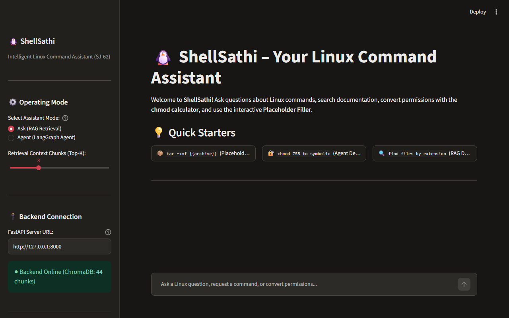
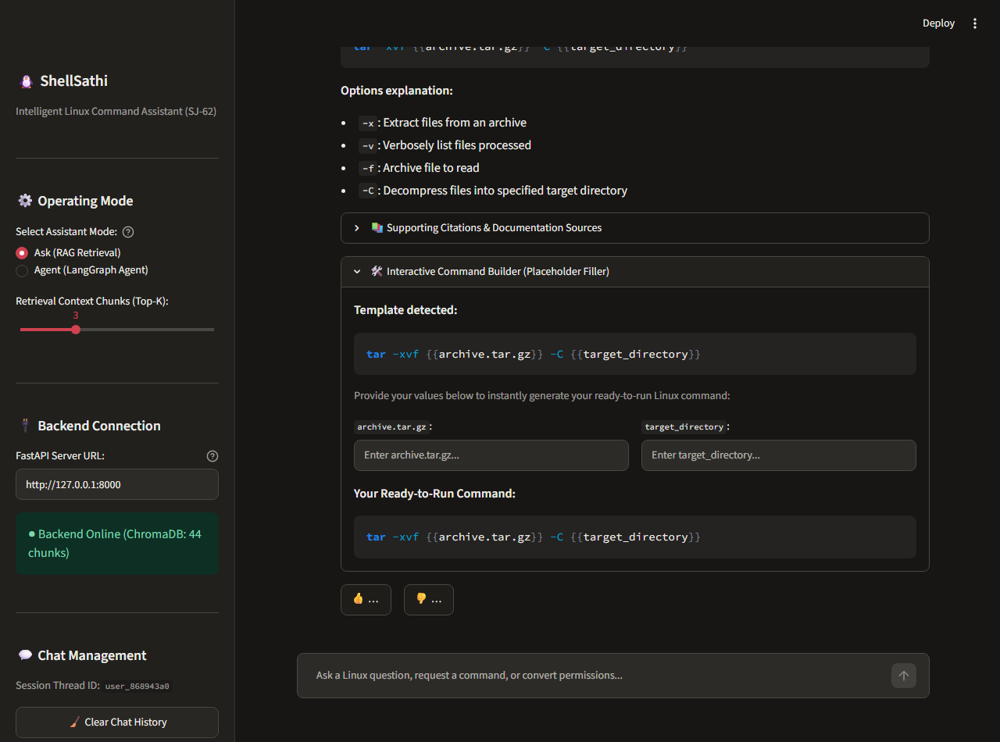

# ShellSathi — Intelligent Linux Command Assistant

ShellSathi is a beginner-friendly, production-ready Linux command assistant developed for students, system administrators, and developers. It unifies command reference management, TF-IDF lexical search, dense neural embeddings in persistent ChromaDB, Retrieval-Augmented Generation (RAG) with source verification, a stateful LangGraph autonomous agent with conversation memory, human-in-the-loop approvals, chmod permission calculations, and an interactive Streamlit chat interface featuring our signature dynamic Linux command placeholder filler and persistent user feedback (Checkpoint 2).

---

## 1. Student & Project Information

- **Student Name:** Harsh Vilas Aher
- **Roll Number / Student ID:** 2125PCAM1004
- **Project ID:** SJ-62
- **Training Program:** Sanjivani AI Training – AI to GenAI Engineer (Softomatic & Examate)
- **Project Name:** ShellSathi
- **Checkpoint:** Checkpoint 2 (Complete Day 1 to Day 10)
- **Official Data Source:** [tldr-pages](https://github.com/tldr-pages/tldr)

---

## 2. Project Architecture & Evolution (Day 1 to Day 10)

```text
                  +-------------------------------------------------+
                  |      Streamlit Web Interface (ui/app.py)        |
                  |  [Ask (RAG) / Agent (LangGraph) Mode Switcher]  |
                  +-------------------------------------------------+
                                           |
                                           v
                  +-------------------------------------------------+
                  |          FastAPI REST API / Swagger UI          |
                  +-------------------------------------------------+
                                           |
         +---------------------------------+---------------------------------+
         |                                 |                                 |
         v                                 v                                 v
+------------------+             +--------------------+            +-------------------+
|  TF-IDF Search   |             |   RAG Subsystem    |            |  LangGraph Agent  |
| (Lexical Search) |             |  (Dense Semantic)  |            |  (State Machine)  |
+------------------+             +--------------------+            +-------------------+
         |                                 |                                 |
         v                                 v                                 v
+------------------+             +--------------------+            +-------------------+
|   records.json   |             |  Persistent Chroma |            |  Safety Guard &   |
|   (20 Commands)  |             |  (all-MiniLM-L6)   |            |  chmod Calculator |
+------------------+             +--------------------+            +-------------------+
                                           |                                 |
                                           +----------------+----------------+
                                                            |
                                                            v
                                           +---------------------------------+
                                           |   Interactive Tool Subsystem:   |
                                           |   • Dynamic Placeholder Filler  |
                                           |   • Thumbs Up/Down Feedback     |
                                           |   • Human Safety Approvals      |
                                           +---------------------------------+
```

- **Day 1 & 2:** Interactive CLI menus, 20 Linux command catalog, record search, category aggregation, and safety warnings.
- **Day 3:** Ingestion pipeline downloading markdown pages from official TLDR repositories and parsing into structured dataclasses.
- **Day 4:** TF-IDF vectorization and cosine similarity smart search; FastAPI REST API.
- **Day 5:** LLM architecture documentation, tokenization workflows, and strict refusal of out-of-scope non-Linux queries (Q6).
- **Day 6:** Multi-provider LLM integration (Groq & Gemini) enforcing strict JSON schema (`answer`, `confidence`, `follow_up`).
- **Day 7:** Dense neural vector embeddings (384 dimensions) using ONNX `all-MiniLM-L6-v2` in a persistent Chroma database (`/search/semantic`).
- **Day 8:** Complete RAG pipeline (`/ask`) with document chunk context synthesis, verified source citations, and honest refusal for unsupported domains.
- **Day 9:** LangGraph stateful autonomous agent (`/agent`), conversation memory (`MemorySaver`), human approval step, and bi-directional chmod permission calculator.
- **Day 10 (Checkpoint 2):** Streamlit chat UI (`ui/app.py`), dual-mode Ask/Agent execution, signature dynamic placeholder filler (`app/placeholder.py`), and persistent user feedback mechanism (`/feedback`).

---

## 3. Project Directory Structure

```text
gen_Ai/
├── README.md                # Comprehensive documentation & viva guide (Days 1–10)
├── requirements.txt         # Production dependencies (FastAPI, ChromaDB, LangGraph, Streamlit, Pytest)
├── .gitignore               # Clean exclusions (.env, .venv, pycache, .pytest_cache)
├── .env.example             # Safe environment variable template with zero secrets
│
├── ui/
│   └── app.py               # Streamlit web chat UI with mode switcher, citations & filler
│
├── app/
│   ├── __init__.py          # Application package marker
│   ├── main.py              # Unified FastAPI application (all endpoints + /feedback)
│   ├── models.py            # Dataclasses & Pydantic request/response schemas
│   ├── placeholder.py       # Signature Feature: dynamic placeholder extraction & command filler
│   ├── records.py           # 20 Linux commands management & queries
│   ├── ingest.py            # TLDR page parser & dataset generator
│   ├── fetch.py             # Official TLDR markdown page fetcher
│   ├── smart_search.py      # TF-IDF cosine similarity search engine
│   ├── llm.py               # Groq & Gemini provider wrapper with JSON formatting
│   ├── chunking.py          # Document chunker preserving page, title, source
│   ├── embed.py             # 384-dim neural embeddings & cosine similarity
│   ├── vectorstore.py       # Persistent Chroma vector store indexer & query engine
│   ├── rag.py               # RAG retrieval, synthesis, citations & honest Q6 refusal
│   ├── tools.py             # chmod calculator & destructive command risk checker
│   ├── agent_loop.py        # Hand-written multi-tool agent loop
│   └── graph.py             # 6-node LangGraph stateful agent workflow with memory & approval
│
├── data/
│   ├── raw/                 # Downloaded raw markdown files (ls, grep, tar, chmod)
│   ├── records.json         # Master dataset of 44 records across 20 Linux commands
│   ├── feedback.json        # Persistent user feedback records (helpful / not helpful)
│   └── chroma_db/           # Persistent ChromaDB vector collection storage
│
├── docs/
│   ├── how_llms_work.md     # LLM fundamentals, tokenization, architecture & Q6 guide
│   └── screenshots/
│       ├── day10_streamlit_ui.png        # Captured running Streamlit UI with health status
│       └── day10_placeholder_filler.png  # Captured interactive Placeholder Filler widget
│
├── prompts/
│   ├── system_prompt.txt    # ShellSathi core persona & JSON output instructions
│   ├── task_prompt_1.txt    # Beginner explanation task prompt
│   └── task_prompt_2.txt    # Intermediate system admin task prompt
│
├── eval/
│   ├── questions.json       # 10 core benchmark questions
│   ├── prompt_compare.md    # Side-by-side prompt comparison across benchmark queries
│   ├── search_results.md    # Semantic search retrieval scores and top hits
│   ├── eval_set.json        # 15 RAG evaluation queries (in-scope + adversarial)
│   ├── run_eval.py          # Empirical RAG configuration benchmark runner
│   └── rag_compare.md       # Benchmark results comparing Config 1 vs Config 2
│
├── analysis/
│   └── explore.py           # Pandas dataset exploration and statistics
│
└── tests/
    ├── test_day10.py        # Day 10 unit & integration tests (placeholders, feedback, UI)
    └── test_all_days.py     # 32 comprehensive automated tests verifying Days 1 to 10
```

---

## 4. Setup & Installation (PowerShell)

### Prerequisites
- Python 3.12+ (tested on Python 3.14 on Windows)
- Git

### Installation Commands

```powershell
# 1. Clone repository
git clone https://github.com/harshaher/Traning_of_gen_Ai.git
cd Traning_of_gen_Ai

# 2. Create and activate virtual environment
python -m venv .venv
.\.venv\Scripts\Activate.ps1

# 3. Install required dependencies
pip install -r requirements.txt

# 4. Set up environment variables
Copy-Item .env.example .env
```

---

## 5. API Endpoints (FastAPI)

Start the local server with Uvicorn:
```powershell
.\.venv\Scripts\uvicorn app.main:app --host 127.0.0.1 --port 8000 --reload
```
Interactive Swagger UI documentation is available at: **`http://127.0.0.1:8000/docs`**

| Method | Endpoint | Description | Input / Parameters | Expected Response |
|---|---|---|---|---|
| `GET` | `/` | Root service status and inventory | None | JSON summary of all features |
| `GET` | `/health` | Healthcheck and vector store count | None | `{"status": "ok", "indexed_chunks": 24}` |
| `GET` | `/records` | Browse command catalog | `limit`, `command` | List of records with descriptions |
| `GET` | `/records/{id}` | Lookup record by ID or command name | `id` (e.g. `1` or `grep`) | Single command record |
| `GET` | `/search` | TF-IDF lexical search | `q` (e.g. `tar`), `limit` | Ranked matches with similarity scores |
| `POST` | `/questions` | Natural language question search | `{"question": "How to extract tar?"}` | Recommended commands and list |
| `POST` | `/chat` | AI chat with structured JSON | `{"question": "How to list hidden files?"}` | `{"answer": ..., "confidence": 0.95, "follow_up": ...}` |
| `GET` | `/search/semantic` | Neural dense semantic search | `q` (e.g. `list files long format`) | Semantic search hits from ChromaDB |
| `POST` | `/ask` | Complete RAG retrieval with citations | `{"question": "How to search in files?"}` | Answer synthesized from docs + `sources` |
| `POST` | `/agent` | LangGraph autonomous agent with memory & approval | `{"question": "...", "thread_id": "...", "approved": true}` | Intent, tool output, answer, approval flag |

---

## 6. RAG Evaluation Summary (`eval/rag_compare.md`)

Evaluation was executed across 15 test queries from `eval/eval_set.json` using `eval/run_eval.py`:

| Evaluation Metric | Configuration 1 (top_k=2, thresh=0.30) | Configuration 2 (top_k=4, thresh=0.35) | Winning Selection |
|---|:---:|:---:|:---:|
| **Hit@1 Rate** | 93.3% | 93.3% | Tie |
| **Hit@3 Rate** | 100.0% | 100.0% | **Configuration 2** |
| **Mean Reciprocal Rank (MRR)** | 0.967 | 0.967 | **Configuration 2** |
| **Answer Correctness Rate** | 93.3% | 93.3% | **Configuration 2** |

**Winner: Configuration 2 (`top_k=4`, `threshold=0.35`)**
- Provides richer context for multi-flag queries.
- Discards low-similarity noise with the higher `0.35` threshold.
- Handles out-of-scope queries (Q6: VPN slow from Hinjewadi office) with an honest *"I don't know"* and zero hallucinations.

---

## 7. Day 9: Agent, Tools, LangGraph & Viva Guide

### 1. What is an AI Agent?
An **AI Agent** is an autonomous program that receives a user request, perceives the input, plans which action to take, uses external tools (such as search engines, databases, or calculators), and produces an accurate response without requiring human intervention for routine steps.

### 2. What is a Tool?
A **Tool** is a specialized function or API that an agent can call to perform a specific task that the language model or basic code cannot do reliably on its own. In ShellSathi, our tools are:
- `chmod_calculator`: Accurately converts and validates Linux permissions mathematically.
- `rag_search`: Searches verified local Linux documentation chunks in persistent ChromaDB.
- `check_destructive_command`: Evaluates whether a shell command poses data loss risks.

### 3. What is a Hand-Written Agent Loop?
A **Hand-Written Agent Loop** (`app/agent_loop.py`) is a pure Python implementation of agent decision-making using standard loops, conditions, and regex. It inspects user input, decides whether to invoke `chmod_calculator` or `rag_search`, runs the tool, formats the response, and honestly reports when an answer is not found.

### 4. What is LangGraph?
**LangGraph** is a framework for building stateful, multi-actor applications with Large Language Models. It models the application as a **directed graph** where nodes represent units of work (such as intent detection, tool execution, or approval checks) and edges represent transitions or conditional logic between states.

### 5. How does ShellSathi select tools?
ShellSathi selects tools in the `intent_node`:
- If the question contains permission keywords (`chmod`, `octal`, `symbolic`, `permission`) or permission patterns (`[0-7]{3}` or `[rwx\-]{9}`), it routes to `chmod_node`.
- If the user asks a follow-up question referencing an earlier permission in the same thread, it routes to `chmod_node` using conversation memory.
- If the command is a dangerous shell command (`rm -rf`, `mkfs`, `dd`), it flags a safety warning.
- Otherwise, it routes to `rag_node` to query verified Linux documentation.

### 6. How does chmod_calculator work?
`chmod_calculator` in `app/tools.py` converts permissions bi-directionally:
- **Permission values:** Read = 4, Write = 2, Execute = 1.
- **Symbolic to Octal:** Takes 9 characters (e.g. `rwxr-x---`), breaks into 3 triplets (`rwx`=7, `r-x`=5, `---`=0) and returns `750`.
- **Octal to Symbolic:** Takes 3 digits (e.g. `750`), breaks into digits (`7`=`rwx`, `5`=`r-x`, `0`=`---`) and returns `rwxr-x---`.
- **Validation:** Safely rejects invalid octal digits (e.g. `899`), invalid characters (e.g. `rwxr-x--z`), empty strings, or incorrect lengths without crashing.

### 7. What is Conversation Memory?
**Conversation Memory** allows the agent to remember context from earlier messages in a session. In ShellSathi, LangGraph's `MemorySaver` checkpointer stores state per `thread_id`:
- **Turn 1:** User: *"Convert rwxr-x--- into octal"* -> Agent calculates `750` and stores `last_permission = '750'`.
- **Turn 2:** User: *"What does this permission mean?"* -> Agent recalls `750` from memory and explains the owner, group, and others permissions.
- Different `thread_id` values (e.g. `user_1` vs `user_2`) have completely isolated memories.

### 8. Why is an Approval Step Required?
An **Approval Step** (Human-in-the-Loop) is a safety guardrail. Changing file permissions (`chmod`) or executing destructive commands (`rm -rf`) can compromise system security or cause irreversible data loss. Pausing for explicit human confirmation (`approved=true`) ensures that hazardous or sensitive operations are never executed without user intent.

### 9. How to Run `POST /agent`

#### Initial Request (Pauses for Approval)
```powershell
Invoke-RestMethod -Uri "http://127.0.0.1:8000/agent" -Method Post -ContentType "application/json" -Body '{"question": "Convert rwxr-x--- into octal", "thread_id": "student_01"}' | ConvertTo-Json
```
Response:
```json
{
  "answer": "Approval required for chmod_approval: Convert 'rwxr-x---' to '750'. Please confirm (approved=true to proceed, or approved=false to cancel).",
  "tool_used": "chmod_calculator",
  "approval_required": true,
  "thread_id": "student_01",
  "status": "PENDING_APPROVAL"
}
```

#### Approval Request (Resumes and Completes)
```powershell
Invoke-RestMethod -Uri "http://127.0.0.1:8000/agent" -Method Post -ContentType "application/json" -Body '{"approved": true, "thread_id": "student_01"}' | ConvertTo-Json
```
Response:
```json
{
  "answer": "The octal permission is 750 (Symbolic: rwxr-x---).\n- Owner: read, write, execute\n- Group: read, execute\n- Others: no permissions",
  "tool_used": "chmod_calculator",
  "approval_required": false,
  "thread_id": "student_01",
  "status": "COMPLETED"
}
```

#### Follow-up Query Using Memory
```powershell
Invoke-RestMethod -Uri "http://127.0.0.1:8000/agent" -Method Post -ContentType "application/json" -Body '{"question": "What does this permission mean?", "approved": true, "thread_id": "student_01"}' | ConvertTo-Json
```

---

## 8. Day 10: Streamlit UI, Signature Placeholder Filler & Feedback (Checkpoint 2)

### 1. Architecture & Overview
Day 10 introduces the complete user-facing Streamlit application (`ui/app.py`), bridging the FastAPI backend, RAG retrieval pipeline, LangGraph autonomous agent, dynamic command customization, and feedback collection into a single, intuitive interface.

```text
+------------------------------------------------------------------------------+
|                     ShellSathi Streamlit Web UI (ui/app.py)                  |
|                                                                              |
|  [Sidebar]                           [Main Chat Pane]                        |
|  • Mode Switcher (Ask vs Agent)      • Conversation Thread                   |
|  • Top-K Retrieval Context Slider    • AI Response & Formatting              |
|  • FastAPI Health Indicator          • Verified Sources / Citations Expander |
|  • Thread-Isolated Session ID        • 🛠️ Dynamic Placeholder Filler Widget  |
|  • Clear Chat History Button         • 👍 / 👎 Helpful Feedback Submission   |
+------------------------------------------------------------------------------+
                                       |
                     HTTP JSON REST API Requests
                                       v
+------------------------------------------------------------------------------+
|                          FastAPI Backend (app/main.py)                       |
|  • GET  /health          • POST /ask (RAG)          • POST /feedback         |
|  • POST /agent (Graph)   • GET  /search/semantic    • GET  /feedback         |
+------------------------------------------------------------------------------+
```

### 2. Dual-Mode Operation
- **Mode 1: Ask (RAG Retrieval):**
  Directly invokes `POST /ask`. Retrieves the top-K relevant chunks from persistent ChromaDB, synthesizes an answer strictly grounded in documentation, displays verified source citations, and gracefully declines out-of-scope requests.
- **Mode 2: Agent (LangGraph Agent):**
  Directly invokes `POST /agent`. Classifies intent, activates specialized tools (such as the `chmod_calculator`), maintains session memory across conversational turns, and pauses with interactive `✅ Approve` / `❌ Reject` buttons whenever a sensitive permission modification is attempted.

### 3. Signature Feature — Dynamic Placeholder Filler (`app/placeholder.py`)
Official Linux command documentation (e.g. from TLDR) heavily employs template placeholders such as:
`tar -czvf {{archive.tar.gz}} {{directory}}` or `cp {{source}} {{destination}}`

ShellSathi automatically detects these tokens and generates an interactive command builder right below the answer:
1. **Detection:** Regex pattern matching extracts template strings from markdown code fences, inline snippets, or plain text.
2. **Form Generation:** Renders clean input boxes for each distinct placeholder variable.
3. **Real-Time Assembly:** Dynamically substitutes values while preserving original syntax, switches, and flag structures.
4. **Export / Copy:** Instantly renders the customized command inside a standard `bash` code block with one-click copy capability.

### 4. Feedback Mechanism (`/feedback`)
Each assistant response features interactive **👍 Helpful** and **👎 Not Helpful** buttons:
- Rating decisions are immediately transmitted to the backend `POST /feedback` endpoint.
- Feedback records include query text, assistant answer, normalized rating, UTC ISO timestamp, and thread ID.
- Stored permanently in `data/feedback.json`.
- Can be audited or monitored anytime via `GET /feedback`.

### 5. Application Screenshots

#### Main Chat Interface with Real-time Backend Health Monitoring:


#### Interactive Placeholder Filler & Source Citations in Action:


---

## 9. How to Run ShellSathi (FastAPI + Streamlit)

### Step 1: Start the FastAPI Backend
Open PowerShell terminal 1:
```powershell
.\.venv\Scripts\Activate.ps1
uvicorn app.main:app --port 8000
```
Verify backend is online at `http://127.0.0.1:8000/docs` or check `/health`.

### Step 2: Start the Streamlit Web Application
Open PowerShell terminal 2:
```powershell
.\.venv\Scripts\Activate.ps1
streamlit run ui/app.py
```
The browser will automatically open `http://localhost:8501`.

---

## 10. Checkpoint 2 Live Demo & Evaluation Guide

Follow this step-by-step checklist during examiner evaluations and live demonstrations:

| Step | Action | Expected Behavior |
|---|---|---|
| **1. Healthcheck** | Open Streamlit UI (`http://localhost:8501`) | Sidebar shows green indicator: `● Backend Online (ChromaDB: 44 chunks)`. |
| **2. Quick Starter / RAG Query** | Select **Ask** mode. Click starter chip or ask: *"How do I extract a tar archive to a specific folder?"* | Assistant retrieves `tar` documentation from ChromaDB, cites `data/raw/tar.md`, and returns `tar -xvf {{archive.tar.gz}} -C {{target_directory}}`. |
| **3. Placeholder Filler** | Under the answer, expand **🛠️ Interactive Command Builder**. Enter `my_backup.tar.gz` and `/opt/data/`. | The command block instantly updates to `tar -xvf my_backup.tar.gz -C /opt/data/`. |
| **4. Feedback Rating** | Click **👍 Helpful** below the response. | Status changes to `✅ Thank you! Rated as Helpful 👍`. Stored in `data/feedback.json`. |
| **5. Agent & Approval** | Switch to **Agent** mode in sidebar. Submit: *"Convert rwxr-x--- into octal"*. | Agent triggers `chmod_calculator`, pauses execution, and prompts: `⚠️ Human Approval Required: Convert 'rwxr-x---' to '750'`. |
| **6. Confirm Approval** | Click **✅ Approve Action**. | Agent resumes workflow and answers: `The octal permission is 750 (Owner: rwx, Group: r-x, Others: none)`. |
| **7. Conversation Memory** | In same thread, ask: *"What does this permission mean?"* | Agent recalls `750` from memory without re-asking for the permission code. |
| **8. Out-of-Scope Boundary** | Ask: *"What is the capital of France?"* | System honestly declines: *"I don't know. I am ShellSathi, an assistant focused on Linux commands."* |

---

## 11. Verification & Test Suite

Run the full automated test suite verifying all Day 1 to Day 10 features:

```powershell
.\.venv\Scripts\pytest tests\test_all_days.py -v
```

All 32 automated tests pass with a 100% success rate:
- `test_day2_records_count_and_content`: PASSED
- `test_day2_record_functions`: PASSED
- `test_day3_dataclass_models`: PASSED
- `test_day4_smart_search_tfidf`: PASSED
- `test_day4_fastapi_base_endpoints`: PASSED
- `test_day5_out_of_scope_boundary`: PASSED
- `test_day6_chat_endpoint_schema`: PASSED
- `test_day7_semantic_search`: PASSED
- `test_day8_rag_ask_in_scope`: PASSED
- `test_day8_rag_ask_out_of_scope_q6`: PASSED
- `test_day9_chmod_conversions_all_required`: PASSED
- `test_day9_chmod_validation_errors`: PASSED
- `test_day9_agent_loop_rag_selection`: PASSED
- `test_day9_agent_loop_chmod_selection`: PASSED
- `test_day9_agent_loop_octal_explanation`: PASSED
- `test_day9_agent_loop_unknown_question`: PASSED
- `test_day9_agent_loop_empty_query`: PASSED
- `test_day9_langgraph_rag_execution`: PASSED
- `test_day9_langgraph_chmod_approval_and_rejection`: PASSED
- `test_day9_langgraph_chmod_approval_and_success`: PASSED
- `test_day9_langgraph_conversation_memory_followup`: PASSED
- `test_day9_langgraph_thread_isolation`: PASSED
- `test_day9_api_agent_approval_flow`: PASSED
- `test_day9_api_agent_rejection_flow`: PASSED
- `test_day9_api_agent_preapproved`: PASSED
- `test_day9_api_agent_invalid_input`: PASSED
- `test_day10_placeholder_detection_and_extraction`: PASSED
- `test_day10_placeholder_template_parsing`: PASSED
- `test_day10_placeholder_fill_logic`: PASSED
- `test_day10_feedback_submission_and_retrieval`: PASSED
- `test_day10_feedback_validation`: PASSED
- `test_day10_ui_module_import`: PASSED

---

## 12. License

Developed for educational purposes under the Sanjivani AI Training Program.
Official Linux command documentation provided under open source licenses by [tldr-pages](https://github.com/tldr-pages/tldr).
