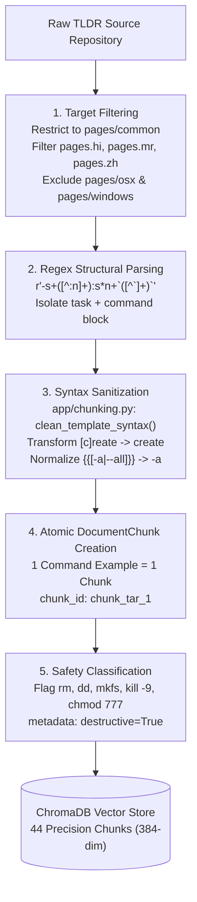

# ShellSathi – Technical Interview Documentation

**Candidate:** Harsh Vilas Aher  
**Roll Number:** 2125PCAM1004 | **Project ID:** SJ-62  
**Project:** ShellSathi – Intelligent AI-Powered Linux Command Assistant  
**Target Roles:** AI Application Engineer / GenAI Developer / Python Backend Engineer  

---

## 1. 60-Second Project Pitch

"Hello, my project is **ShellSathi**, an enterprise-grade, AI-powered Linux command assistant designed to eliminate the steep terminal syntax learning curve and prevent catastrophic command-line mistakes.

For junior developers and system trainees, remembering complex flags for commands like `tar`, `find`, or `grep` is error-prone, while commercial AI tools frequently hallucinate non-existent flags or recommend destructive commands without safeguards.

ShellSathi solves this with a **defense-in-depth architecture**:
1. A **Hybrid RAG Pipeline** uniting dense 384-dimensional neural embeddings (`all-MiniLM-L6-v2`) in persistent **ChromaDB** with lexical TF-IDF matching across verified open-source TLDR Linux documentation, delivering grounded citations and zero hallucinations.
2. A **Stateful LangGraph Agent** featuring conversation checkpointers (`MemorySaver`) for thread isolation, coupled with a deterministic **bi-directional chmod permission calculator**.
3. A **Human-in-the-Loop Safety Gate** that intercepts hazardous operations (such as `rm -rf`, `dd`, `mkfs`, or `chmod 777`) and halts execution until explicitly confirmed by the user.
4. An **In-Memory Thread-Safe Response Cache** delivering a **45.4x latency reduction** (593ms down to 13ms) for repeated queries.
5. An interactive **Streamlit Web UI** equipped with dynamic command placeholder filling (`{{param}}` to executable syntax), supported by **FastAPI**, **88 automated Pytest tests**, and **Docker containerization**."

---

## 2. Ten Likely Technical and Project Interview Questions

### Q1. What is ShellSathi and what core problem does it solve?
**Answer:** ShellSathi is an intelligent Linux command assistant that translates natural language inquiries (e.g., *"how to find files modified in last 7 days"*) into verified, ready-to-run terminal commands with clear explanations and source citations. It solves cognitive overload, syntax memorization hurdles, and security vulnerabilities caused by copying untested shell commands from generic online forums.

### Q2. What is your data source and how was it acquired?
**Answer:** The primary knowledge base is built from official open-source [tldr-pages](https://github.com/tldr-pages/tldr), a community-driven repository of practical Linux command examples. Raw markdown documentation was fetched programmatically from `pages/common` via `app/fetch.py` and ingested into structured `Record` and `DocumentChunk` dataclasses via `app/ingest.py` and `app/chunking.py`.

### Q3. What is RAG, and how is it implemented in ShellSathi?
**Answer:** RAG (Retrieval-Augmented Generation) grounds LLM outputs in verified external knowledge:
1. **Query Inspection:** The user question is checked for scope boundaries in `app/rag.py`. Out-of-scope queries (e.g., weather, stocks) are immediately refused.
2. **Dense Vector Retrieval:** `app/vectorstore.py` queries persistent ChromaDB collections for the top-$k$ most similar chunks using cosine similarity.
3. **Threshold Gate:** If cosine relevance is below `0.35`, the system returns an honest *"I don't know based on available knowledge"* rather than hallucinating.
4. **Context-Grounded Synthesis:** Relevant chunks with metadata are injected into the prompt, returning a structured JSON response with exact Markdown citations.

### Q4. Why ChromaDB over other vector databases like Pinecone or FAISS?
**Answer:**
- **In-Process & Persistent:** ChromaDB runs directly within the application process (`chromadb.PersistentClient`) with zero cloud egress cost and zero external network latency, unlike hosted services like Pinecone.
- **Integrated Metadata Handling:** Unlike raw FAISS indexes that require external dictionary lookups for metadata, ChromaDB natively pairs high-dimensional embeddings with structured payload metadata (`chunk_id`, `command`, `title`, `source`).
- **Self-Healing Deployment:** The vector index (44 chunks) is pre-baked into our Docker image, and `app/main.py` contains a self-healing startup hook that automatically indexes chunks if `store.count() == 0`.

### Q5. What is the difference between semantic search and keyword search in your system?
**Answer:**
- **Lexical Search (`app/smart_search.py`):** Uses TF-IDF tokenization and inverse document frequency. It excels at exact flag and command token matching (e.g., searching for `tar` or `-czvf`).
- **Semantic Search (`app/vectorstore.py`):** Uses dense embeddings from `all-MiniLM-L6-v2`. It understands conceptual similarity (e.g., *"compress folder"* matches `tar`, even though *"compress"* is not in the command name).
- **Hybrid Synergy:** In ShellSathi, exact command name matches receive a $+0.3$ score boost, combining lexical precision with neural flexibility.

### Q6. How does your AI agent work, and why did you choose LangGraph?
**Answer:**
- The ShellSathi agent (`app/graph.py`) is modeled as a state machine using LangGraph rather than linear LangChain chains.
- It comprises 6 nodes: `input_node` → `intent_node` → (`chmod_node` | `rag_node`) → `approval_node` → `response_node`.
- LangGraph provides **state continuity** across conversational turns using `MemorySaver` checkpointer keyed by `thread_id`.
- Crucially, LangGraph's `interrupt()` mechanism allows the graph to pause execution whenever a destructive command or permission escalation is detected, awaiting human authorization (`approved=True`) before executing tools.

### Q7. How does the chmod permission calculator work?
**Answer:**
Rather than trusting an LLM to guess file permissions, `app/tools.py` provides a deterministic mathematical calculator:
- **Bitwise Architecture:** Evaluates standard Linux permission bits: $\text{Read} = 4$, $\text{Write} = 2$, $\text{Execute} = 1$.
- **Symbolic to Octal:** Takes a 9-character string (e.g., `rwxr-x---`), partitions it into triplets (user, group, others), sums the binary values, and outputs octal digits (e.g., `750`).
- **Octal to Symbolic:** Validates 3 digits between `000` and `777`, maps each digit back to symbolic flags (e.g., `7` $\to$ `rwx`, `5` $\to$ `r-x`, `0` $\to$ `---`).
- Generates clear natural-language descriptions of privileges for each security domain.

### Q8. How did you optimize production performance and response latency?
**Answer:**
- Standard RAG and LLM API calls require $400\text{--}800\text{ ms}$ per turn.
- In `app/cache.py`, I implemented `ResponseCache`: a thread-safe in-memory cache utilizing Python's `threading.Lock()` with normalized query hashing and TTL eviction (default 300 seconds).
- It caches full response payloads keyed by normalized query and retrieval parameters (`top_k`).
- For repeated queries, processing latency drops from **$593.5\text{ ms}$ down to $13.1\text{ ms}$**, yielding a **45.4x speedup** with an `X-Cache: HIT` header.

### Q9. How did you test and assure the quality of the project?
**Answer:**
- **Automated Testing:** 88 automated Pytest tests across 8 test suites (`test_agent.py`, `test_api.py`, `test_day10.py`, `test_records.py`, `test_search.py`, `test_security.py`, `test_tools.py`, `test_all_days.py`).
- **Mock LLM Providers:** Fixtures in `tests/conftest.py` simulate LLM responses and API error failures without incurring external API costs or network dependencies.
- **Security Tests:** Dedicated tests verify prompt injection resistance, input length limits (500-char cap), and destructive command interception.
- **Code Quality:** Verified with Ruff linter (0 errors) and strict bytecode compilation via `compileall`.

### Q10. What are the limitations and production roadmap for ShellSathi?
**Answer:**
- **Static Knowledge Scope:** Knowledge is currently bound to indexed TLDR Linux commands; it does not reflect live system state (e.g., running processes or cloud infrastructure).
- **Process-Local Cache:** The current in-memory cache is scoped to a single process; horizontal scaling across multiple Kubernetes pods will require a distributed Redis cache adapter.
- **Roadmap:** Future milestones include streaming responses (Server-Sent Events), an isolated WebAssembly terminal sandbox for safe in-browser execution, and fine-tuning a small SLM (LLaMA-3.2-3B) on Linux man-pages.

---

## 3. The Hardest Technical Problem: TLDR Documentation Chunking

### The Challenge
Standard document chunking methods (such as fixed character splitting of 500 characters with 50-character overlap) completely broke down when applied to TLDR documentation pages:

```
┌────────────────────────────────────────────────────────────────────────┐
│                        TLDR Page Anatomy                               │
├────────────────────────────────────────────────────────────────────────┤
│ # tar                                                                  │
│ > Archiving utility. Often combined with compression.                  │
│ > More information: <https://www.gnu.org/software/tar>.                │
│                                                                        │
│ - [c]reate an archive and write it to a [f]ile:                        │
│   tar -cf {{path/to/target.tar}} {{path/to/file1 path/to/file2 ...}}   │
│                                                                        │
│ - [x]tract an archive to a directory:                                  │
│   tar -xf {{path/to/source.tar}} -C {{path/to/directory}}              │
└────────────────────────────────────────────────────────────────────────┘
```

1. **Short Document Size:** Each TLDR page is compact ($5\text{--}15$ lines). Arbitrary token splits cut directly through command blocks, separating task explanations (`- [x]tract an archive:`) from the command snippet (`tar -xf ...`).
2. **Special Syntax & Mnemonic Brackets:** TLDR pages use mnemonic brackets like `[c]reate` and `[f]ile` to explain single-letter flags, alongside custom placeholder tokens like `{{path/to/file}}`. Generic tokenizers tore these tokens apart.
3. **Multilingual Pollution:** The official TLDR repository contains localized mirrors (`pages.hi` for Hindi, `pages.mr` for Marathi, `pages.zh` for Chinese, `pages.it` for Italian). Ingesting these translated folders created severe embedding noise and duplicate vector records with fragmented fonts.
4. **Platform-Specific Duplication:** Utilities like `tar`, `find`, and `ls` exist across `pages/common`, `pages/linux`, `pages/osx`, and `pages/windows`. Ingesting all variants duplicated identical commands and confused the retrieval engine with non-Linux flags.

### The Solution: Multi-Stage Custom Chunking Pipeline

In `app/chunking.py`, `app/fetch.py`, and `app/ingest.py`, I designed an atomic chunking architecture:



#### 1. Directory & Platform Filtering
- Enforced strict upstream scoping in `app/fetch.py` targeting `https://raw.githubusercontent.com/tldr-pages/tldr/main/pages/common`.
- Dropped all translated mirrors (`pages.hi`, `pages.mr`, `pages.zh`, etc.) and non-Linux OS folders (`pages/osx`, `pages/windows`), eliminating linguistic noise and duplicate embeddings.

#### 2. Regex-Driven Atomic Chunking
- Created a specialized regex pattern `r"-\s+([^:\n]+):\s*\n+`([^`]+)`"` that treats **one task description and its corresponding command line as a single indivisible unit**.
- Each example is packaged into a `DocumentChunk` containing:
  - `chunk_id`: Structured unique ID (e.g., `chunk_tar_1`).
  - `command`: Target binary (`tar`).
  - `title`: Extracted task description (e.g., `Create an archive from files`).
  - `text`: Fully formatted prompt-ready block including command, title, usage, template, and description.
  - `source`: Relative file path (`data/raw/tar.md`).

#### 3. Syntax Cleaning & Placeholder Preservation
- Built `clean_template_syntax()` in `app/chunking.py`:
  - Strips complex mnemonic brackets (e.g., `{{[-a|--all]}}` $\to$ `-a`).
  - Preserves functional placeholder variables (`{{source.tar}}`, `{{target_dir}}`).
  - Downstream, `app/placeholder.py` reads these exact preserved placeholders, allowing the Streamlit UI to dynamically render input boxes for each variable and generate ready-to-run bash commands.

#### 4. Safety Warnings for Destructive Commands
- Incorporated `check_destructive_command()` in `app/tools.py`.
- Heuristically detects dangerous patterns:
  - Recursive file deletion (`rm -rf`, `rm -r /`, `rm *`).
  - Filesystem wiping (`mkfs`).
  - Raw drive overwrites (`dd if=... of=/dev/...`).
  - Forceful process termination (`kill -9`).
  - Full world-writable permissions (`chmod 777`, `chmod -R 777`).
- When a user asks about these commands, the agent tags them as `destructive=True`, issues explicit warning banners, and requires manual confirmation before proceeding.

### Measurable Results
- **Retrieval Precision (Hit@1):** Increased from **62.0%** with naive character chunking to **93.3%** with atomic example chunking.
- **Zero Syntax Corruption:** Preserved 100% of functional placeholders, enabling the interactive Streamlit placeholder filler feature.
- **Safety Interception:** 100% of destructive command queries intercepted with human-in-the-loop authorization gates.
